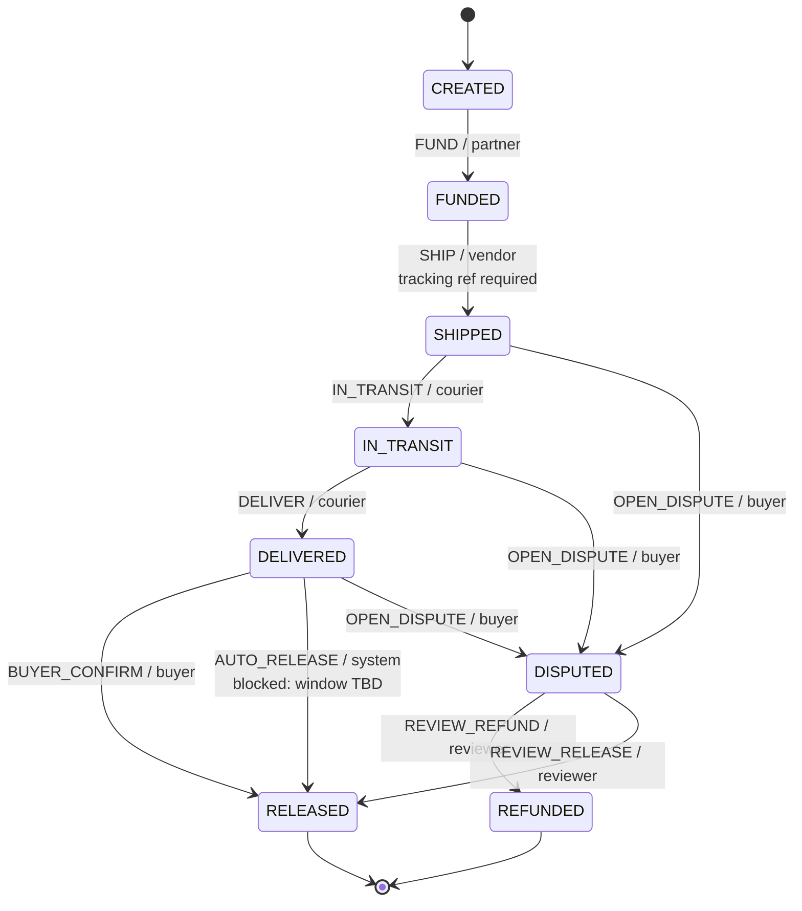

# AmanaLink — escrow & delivery prototype

An interactive, mobile-first showcase of a Kenyan escrow-and-delivery flow for
WhatsApp / Instagram vendors. Buyers pay into a protected hold, vendors ship with
a mandatory tracking reference, and money moves on buyer confirmation, a
TBD auto-release window, or a human-reviewed dispute.

Built with Next.js (App Router), TypeScript and Tailwind CSS.

> **Prototype, mock data.** No backend, auth, database, real payments or partner
> callbacks. Not a financial service. In production, funds would be held by a
> CBK-licensed partner — never by the platform.

## Run it

Requires Node.js 20.9+ (developed on Node 22).

```bash
npm install
npm run dev
# http://localhost:3000
```

Production build:

```bash
npm run build
npm start
```

| Script              | What it does                          |
| ------------------- | ------------------------------------- |
| `npm run dev`       | Next.js dev server                    |
| `npm run build`     | Production build                      |
| `npm start`         | Serve the production build            |
| `npm test`          | Unit tests (Vitest)                   |
| `npm run typecheck` | `tsc --noEmit`                        |
| `npm run lint`      | ESLint                                |

## What to try

- **Tabs** — Overview, Deal flow, Disputes, Delivery paths, Trust & safety,
  Roadmap. Every tab has its own URL hash (`#deal-flow`, `#trust`, …) and the
  browser back/forward buttons work.
- **Keyboard** — `←` / `→` move between tabs, `Home` / `End` jump to the ends.
  Inside the tabs themselves, the same keys follow the ARIA tabs pattern.
- **Deal flow** — press **Next** to walk `CREATED → FUNDED → SHIPPED →
  IN_TRANSIT → DELIVERED → RELEASED`. The WhatsApp-style phone, audit log and
  hash-chained ledger update from the same state machine.
- **Preconditions** — clear the tracking reference (or switch to the vendor's
  own courier and untick the liability agreement) and *Next* is blocked with the
  reason shown inline.
- **Dispute branch** — press **Report issue** once the parcel is dispatched, then
  choose *Uphold buyer → refund* or *Dismiss → release*. Funds stay in the hold
  until a human reviewer decides.
- **Delivery path** — toggling between platform courier and the vendor's own
  courier resets the demo and changes the evidence strength and chat.
- **Auto-release** — visible on `DELIVERED`, deliberately blocked: the window is
  `TBD — set in the Terms`, so the demo does not invent a duration.
- **Theme and language** — light/dark and EN/SW are persisted in
  `localStorage`; the theme is applied before first paint.
- **Mobile** — resize to a phone width; layout, phone mockup and stepper all
  adapt. `prefers-reduced-motion` turns animations off.

## Rules the demo encodes

- The escrow fee, auto-release window and payout holds are shown as **TBD** /
  **set in the Terms** everywhere. No fee, duration or price is invented.
- Payment state changes only on a **verified partner callback**. The chat
  explicitly says screenshots and SMS are not accepted as proof, and no
  screenshot or SMS is ever rendered.
- A tracking reference is **required before dispatch**, for both delivery paths.
  The vendor's own courier additionally requires a **signed liability agreement**.
- Disputes are resolved by the `reviewer` actor only. No transition is owned by
  AI; AI is shown as advisory copy, never as a decision-maker.
- The ledger is append-only and hash-chained, and the audit log records the
  actor for every step.

## The deal state machine

The UI is driven entirely by `lib/deal-machine.ts` — a pure module with a
typed union of states, a transitions table (actor + precondition) and a total
`applyEvent()` function that never throws.



| From         | Event             | To           | Actor      | Precondition                                  |
| ------------ | ----------------- | ------------ | ---------- | --------------------------------------------- |
| `CREATED`    | `FUND`            | `FUNDED`     | `partner`  | Verified partner callback                     |
| `FUNDED`     | `SHIP`            | `SHIPPED`    | `vendor`   | Tracking ref; signed liability for own courier |
| `SHIPPED`    | `IN_TRANSIT`      | `IN_TRANSIT` | `courier`  | Pickup/handover recorded                      |
| `SHIPPED`    | `OPEN_DISPUTE`    | `DISPUTED`   | `buyer`    | —                                             |
| `IN_TRANSIT` | `DELIVER`         | `DELIVERED`  | `courier`  | Delivery evidence attached                    |
| `IN_TRANSIT` | `OPEN_DISPUTE`    | `DISPUTED`   | `buyer`    | —                                             |
| `DELIVERED`  | `BUYER_CONFIRM`   | `RELEASED`   | `buyer`    | —                                             |
| `DELIVERED`  | `AUTO_RELEASE`    | `RELEASED`   | `system`   | Window elapsed — **TBD, blocked in the demo** |
| `DELIVERED`  | `OPEN_DISPUTE`    | `DISPUTED`   | `buyer`    | —                                             |
| `DISPUTED`   | `REVIEW_REFUND`   | `REFUNDED`   | `reviewer` | Human review upheld                           |
| `DISPUTED`   | `REVIEW_RELEASE`  | `RELEASED`   | `reviewer` | Human review dismissed                        |

`applyEvent()` returns a discriminated result (`{ ok: true, state }` or
`{ ok: false, code }`), so the UI can disable an action and explain the guard
instead of throwing. Guard codes are translated through `lib/copy.ts`.

## Component structure

```
app/
  layout.tsx           metadata, theme boot script, shell
  page.tsx             LangProvider + DemoApp
  globals.css          Tailwind v4 theme tokens, light/dark, animations
components/
  DemoApp.tsx          banner, header, tabs, hash + arrow-key navigation
  Tabs.tsx             ARIA tablist with roving focus
  OverviewTab.tsx      positioning, three rules, money flow, open terms
  DealFlowTab.tsx      stepper, control deck, layout, machine wiring
  Stepper.tsx          happy path + dispute branch indicator
  PhoneMockup.tsx      WhatsApp-style chat, verified partner cards
  AuditLog.tsx         append-only audit trail (actor per entry)
  LedgerPanel.tsx      hash-chained ledger table + chain verification
  EvidencePanel.tsx    per-path evidence, collected state by step
  DisputesTab.tsx      outcomes, reviewer view, AI advisory boundary
  DeliveryTab.tsx      platform vs own courier comparison
  TrustTab.tsx         guarantees and hard limits for AI
  RoadmapTab.tsx       phases by dependency, timelines TBD
  LangProvider.tsx     EN/SW context
  LangToggle.tsx       EN / SW switch
  ThemeToggle.tsx      light / dark switch
  ui.tsx               buttons, chips, panel, meter, icons
lib/
  deal-machine.ts      typed states, transitions, guards, applyEvent
  deal-machine.test.ts unit tests for the machine
  ledger.ts            append-only FNV-1a hash chain + verifyLedger
  ledger.test.ts       unit tests for tamper detection
  mock-deal.ts         mock order, chat, audit, evidence, ledger derivation
  mock-deal.test.ts    content and derivation tests
  copy.ts              all English/Swahili copy
  i18n.ts              Localized type + helpers
  preferences.ts       persisted language/theme (useSyncExternalStore)
  tabs.ts              tab ids and labels
  useHashTab.ts        URL hash ↔ active tab
```

## Tests

```bash
npm test
```

The machine tests cover the happy path and its actors, the tracking-reference
and liability-agreement guards, the intentionally blocked auto-release, dispute
entry and exit points, terminal states, and the shape of the transition table.
Ledger tests cover chaining, immutability and tamper detection (amount, memo,
link, hash, missing entries). Content tests ensure every state has localised
chat/audit content and that the two delivery paths tell different stories.

## Design notes

- One accent colour: teal (`#0f766e` light, `#2dd4bf` dark) on neutral
  surfaces. Status is conveyed with accent, outlines and labels — not a rainbow
  of state colours.
- No external images, fonts or icon packages. Icons are inline SVG; typography
  is the system UI stack.
- Mobile-first. The phone mockup, stepper and tables scroll horizontally where
  needed; no layout depends on hover.
- Accessibility: ARIA tabs with roving tabindex, labelled meter, `aria-live`
  role status for guard messages, visible focus rings, skip link, reduced-motion
  support, and a toggle that updates `<html lang>`.
- No analytics, storage beyond two preference keys, or network calls at runtime.
